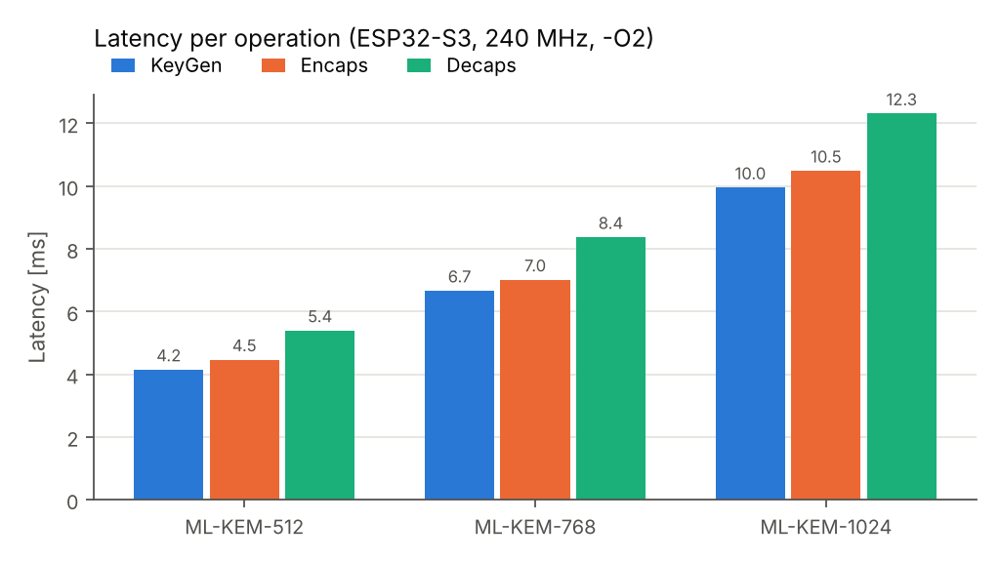
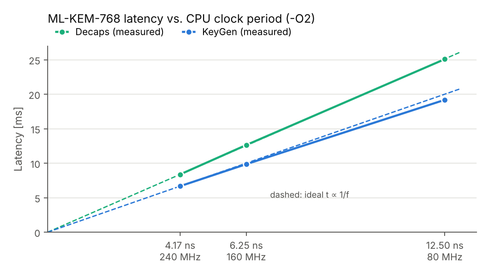
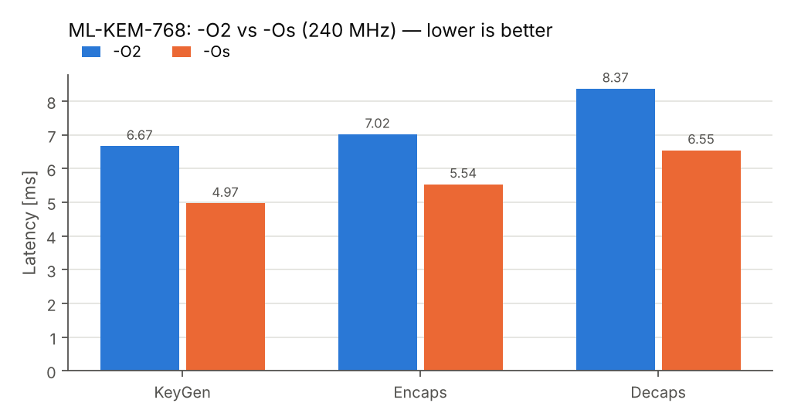
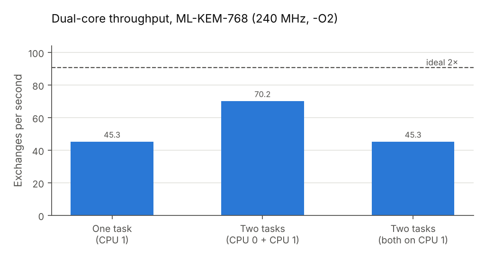

# ML-KEM on the ESP32-S3

**Author:** Lawrence Shin

How fast is post-quantum key exchange on a small microcontroller? This project runs **ML-KEM** (the NIST post-quantum key-encapsulation standard, FIPS 203) on an **ESP32-S3** and measures it: speed at each security level, the effect of CPU clock and compiler settings, the gain from using both CPU cores, and memory use.

The code is C++ on ESP-IDF. The ML-KEM implementation is [mlkem-native](https://github.com/pq-code-package/mlkem-native), a portable C library, included as a git submodule.

## Results at a glance

| | Result |
|---|---|
| Full ML-KEM-768 exchange (KeyGen + Encaps + Decaps) | **22.1 ms** at 240 MHz |
| Device side of a handshake (KeyGen + Decaps) | **15.0 ms**, or **11.5 ms** with `-Os` |
| Compared with a laptop running the same C code | about **195× slower** |
| Effect of CPU clock | time scales with 1/clock: the work is compute-bound |
| `-Os` instead of `-O2` | **1.29× faster** and **25 % smaller** |
| Two cores instead of one | **1.55× more** key exchanges per second |
| Peak stack (512 / 768 / 1024) | **19.9 / 28.0 / 37.7 KB** |
| Correctness | all 10 runs passed every test |

In short, ML-KEM is fast enough on the ESP32-S3 for one key exchange per connection, and the compiler setting has a surprisingly large effect.

## Setup

| | |
|---|---|
| Board | ESP32-S3 (QFN56, rev. v0.2), 2 × Xtensa LX7 @ 240 MHz, 16 MB flash (DIO, 80 MHz), 8 MB PSRAM (not enabled) |
| Laptop (for comparison) | Lenovo ThinkPad X1 Yoga Gen 8, Ubuntu, x86-64 |
| Software | ESP-IDF v5.5.6, GCC 14.2.0, mlkem-native `eae4179` (plain C, no assembly, on both machines) |

**How it was measured**

- Every run first checks correctness: fixed test vectors must match byte for byte, both sides of a key exchange must get the same secret, and tampered keys or ciphertexts must be handled correctly.
- Timing uses `esp_timer_get_time()` (microseconds). Each number is the average of 20 runs on the board, or 1000 on the laptop.
- Peak stack is read from FreeRTOS's stack high-water mark.
- Default settings are 240 MHz, `-O2` and ML-KEM-768. Only one setting is changed per test.

## Results

### Security level



| Level | KeyGen | Encaps | Decaps | Total | vs. laptop |
|---|---:|---:|---:|---:|---:|
| ML-KEM-512  | 4.15 ms | 4.47 ms | 5.40 ms | **14.0 ms** | 185× |
| ML-KEM-768  | 6.67 ms | 7.02 ms | 8.37 ms | **22.1 ms** | 195× |
| ML-KEM-1024 | 9.96 ms | 10.49 ms | 12.32 ms | **32.8 ms** | 188× |

- Going from 512 to 768 costs about 1.6× the time, and to 1024 about 2.3–2.4×. The laptop shows almost the same ratios, so the board is uniformly slower, not worse at high security.
- Decaps is always the slowest operation, because it re-encrypts the message to check the ciphertext.
- Of the ~195× gap, roughly 20× is clock speed (240 MHz vs. several GHz). The rest is the simpler CPU: in-order, 32-bit, and running code from external flash.

### CPU clock



| Clock | KeyGen | Encaps | Decaps |
|---|---:|---:|---:|
| 240 MHz | 6.67 ms | 7.02 ms | 8.37 ms |
| 160 MHz | 9.86 ms | 10.52 ms | 12.64 ms |
| 80 MHz | 19.19 ms | 20.67 ms | 25.08 ms |

Time grows almost exactly in proportion to the clock period: at 80 MHz, Decaps takes 2.995× longer than at 240 MHz (ideal: 3×). Fitting `time = cycles / clock + fixed delay` shows that at most about 6 % of the time is spent waiting for memory, so ML-KEM here is **compute-bound**. Running at a lower clock to save power makes the key exchange take proportionally longer.

### Compiler optimisation: `-O2` vs `-Os`



| Build | KeyGen | Encaps | Decaps | Total | ML-KEM code size |
|---|---:|---:|---:|---:|---:|
| `-O2` (optimise for speed) | 6.67 ms | 7.02 ms | 8.37 ms | 22.1 ms | 13 697 B |
| `-Os` (optimise for size) | 4.97 ms | 5.54 ms | 6.55 ms | **17.1 ms** | **10 200 B** |
| Difference | 1.34× faster | 1.27× faster | 1.28× faster | **1.29× faster** | **25 % smaller** |

This was the most surprising result: the "optimise for size" build is faster at everything, and stack use stays the same. Smaller code usually helps by causing fewer cache misses, but the clock test shows memory waits are only a few percent of the time. So most of the gain must come from the instructions themselves, likely because `-O2` inlines and unrolls more code, which costs extra on the Xtensa CPU. The exact cause has not been measured.

### Two CPU cores



| Setup | Time for 50 exchanges | Exchanges per second | Speed-up |
|---|---:|---:|---:|
| 1 task on one core | 1103.7 ms | 45.3 | 1.00× |
| 2 tasks on both cores | 712.6 ms | 70.2 | **1.55×** |
| 2 tasks sharing one core | 1103.0 ms | 45.3 | 1.00× |

- Both cores together give 1.55×, not 2×. The two cores share the cache, the flash chip and RAM, so they slow each other down a little.
- Two tasks on the same core give no gain at all, and no measurable overhead either.
- Check: 1103.7 ms ÷ 50 = 22.07 ms per exchange, which matches the 22.06 ms measured separately in the security-level test.

### Memory

| Level | Peak stack | Suggested stack (+25 %) |
|---|---:|---:|
| ML-KEM-512 | 19 900 B | 25 KB |
| ML-KEM-768 | 28 028 B | 35 KB |
| ML-KEM-1024 | 37 676 B | 47 KB |

ML-KEM keeps all its working data on the stack and uses no heap. ESP-IDF's default `app_main` stack is only 3.5 KB, so ML-KEM has to run in its own FreeRTOS task. This project uses 48 KB, which covers all three levels.

### Takeaways

1. ML-KEM is practical on the ESP32-S3: about 15 ms of device-side work per connection, small next to Wi-Fi connection times of a second or more.
2. Try `-Os`. Here it was both faster and smaller than `-O2`.
3. Give ML-KEM its own task with enough stack: 35 KB for 768, 47 KB for 1024.
4. Keep the CPU at 240 MHz during the key exchange.
5. Using both cores for parallel key exchanges gives about 1.5×, not 2×.

### Notes on the numbers

- Averages of 20 runs. A repeated baseline run differed by only about 0.3 %.
- One board, one compiler version. `-Os` was applied to the whole firmware, not only to ML-KEM.
- Flash in DIO mode with default cache sizes; PSRAM off.
- All raw numbers are in [`data/`](data/). Run `python3 scripts/plot_results.py` to redraw the charts.

## Repository layout

```
.
├── common/
│   ├── mlkem.hpp            # C++ wrapper: fixed-size key types, secure wiping
│   ├── experiments.hpp      # correctness tests + benchmark (shared by laptop and board)
│   └── kat_vectors.h        # test vectors (from mlkem-native)
├── host/                    # laptop version (make)
├── esp32s3/                 # ESP-IDF project: tests, benchmark, stack use
├── esp32s3_dualcore/        # ESP-IDF project: one core vs two cores
├── data/                    # measured results (CSV)
├── scripts/plot_results.py  # redraws docs/figures/ from data/
├── docs/figures/            # charts
└── mlkem-native/            # git submodule (ML-KEM library)
```

## Run it yourself

You need Linux with `g++`/`make`, [ESP-IDF v5.5](https://docs.espressif.com/projects/esp-idf/en/v5.5/esp32s3/get-started/), and an ESP32-S3 board.

```bash
git clone --recurse-submodules https://github.com/<your-user>/mlkem-esp32s3.git
cd mlkem-esp32s3
```

**On the laptop:**

```bash
cd host
make run              # ML-KEM-768; also: make run LEVEL=512 or LEVEL=1024
```

**On the ESP32-S3:**

```bash
source ~/esp/esp-idf/export.sh
cd esp32s3
idf.py set-target esp32s3             # once per project folder
idf.py -p /dev/ttyUSB0 flash monitor  # Ctrl+] to exit
```

The output ends with something like:

```
=== Experiment 4: benchmark (20 rounds each) ===
  op           avg [us]   ops / second
  keygen         6669.0          149.9
  encaps         7017.4          142.5
  decaps         8373.9          119.4
...
All experiments passed. Press RESET (RST/EN) to run again.
```

**Dual-core test:** the same commands in `esp32s3_dualcore/`.

### Settings

| What | Where |
|---|---|
| Security level | `esp32s3/components/mlkem/CMakeLists.txt` → `set(MLKEM_LEVEL 768)` (used by both firmware projects) |
| CPU clock | `idf.py menuconfig` → Component config → ESP System Settings → CPU frequency |
| Optimisation | `idf.py menuconfig` → Compiler options → Optimization Level |
| Task stack | `kStackBytes` in `main/main.cpp` (48 KB) |

`sdkconfig` files are not committed; each project starts from its `sdkconfig.defaults`.

This is a benchmarking and learning project. It prints secrets for demonstration, so don't use it as-is to protect real data.

## Licence

Copyright © 2026 Lawrence Shin. Released under the MIT licence (see [LICENSE](LICENSE)). mlkem-native and `common/kat_vectors.h` are © the mlkem-native project authors (Apache-2.0 OR ISC OR MIT).
